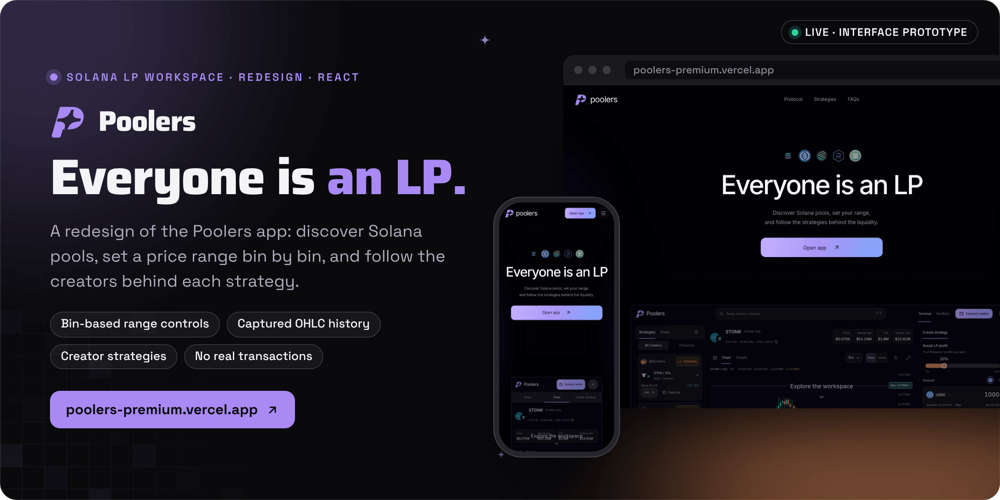

<div align="center">



<br><br>

<a href="https://poolers-premium.vercel.app"></a>&nbsp;&nbsp;
<a href="https://poolers-premium.vercel.app/app"></a>&nbsp;&nbsp;
<a href="https://app.poolers.xyz"></a>

<br><br>

<a href="https://poolers-premium.vercel.app"></a>


<h3>Discover Solana pools, set your range, and follow the strategies behind the liquidity.</h3>

<b>Find a pool</b> &nbsp;→&nbsp; <b>Read the chart</b> &nbsp;→&nbsp; <b>Shape your range</b> &nbsp;→&nbsp; <b>Join a creator</b> &nbsp;→&nbsp; <b>Track your positions</b>

<br>

<a href="#how-it-works">How it works</a> &nbsp;·&nbsp;
<a href="#status">Status</a> &nbsp;·&nbsp;
<a href="#run-it-locally">Run it locally</a> &nbsp;·&nbsp;
<a href="#data-and-credits">Data and credits</a>

</div>

<br>

<picture>
  <source media="(prefers-color-scheme: dark)" srcset="docs/readme/screens-dark.png">
  
</picture>

<p align="center"><sub>Captured from the live prototype, poolers-premium.vercel.app, on 11 November 2026 at 1440 by 900. Balances and positions are the local workspace's starting state, not real funds.</sub></p>

**Poolers is a redesign of the [Poolers](https://app.poolers.xyz) app, a workspace for Solana liquidity providers.** It covers the landing page, the trading terminal, the portfolio, the profile and sign-up, built in React on market, strategy and price history captured from public Poolers endpoints. Everything you do in it, from funding a wallet to opening a position or following a creator, stays in your browser: it never connects a real wallet, asks for a signature or sends a transaction.

Built by Matt ([RVAClassic](https://x.com/rvaclassic), [Operator Uplift](https://operatoruplift.com)) between 8 and 10 November 2026, as an interface prototype separate from the production Poolers app.

<br>

## How it works

<picture>
  <source media="(prefers-color-scheme: dark)" srcset="docs/readme/flow-dark.png">
  
</picture>

<table>
  <tr valign="top">
    <td width="33%"><b>Exact bin math</b><br><sub>Prices are exact DLMM bin prices, <code>activePrice × (1 + binStep / 10000)^bin</code>. Range handles on the histogram never cross, and Min and Max can be dragged, typed or moved one bin at a time.</sub></td>
    <td width="33%"><b>A real chart</b><br><sub>Original OHLC history with volume, a crosshair, pan and zoom, timeframe aggregation and price or market-cap views, with minimum and maximum price lines linked to the range composer.</sub></td>
    <td width="33%"><b>Social LP</b><br><sub>Set a Social LP profit share from 5 to 25 percent, follow creators by their real avatars, filter by All creators or Following, join strategies and copy strategy links.</sub></td>
  </tr>
  <tr valign="top">
    <td width="33%"><b>Links that open directly</b><br><sub><code>/pools/:address</code> opens a shareable pool workspace and <code>/strategy/:id</code> a shared strategy's review, both with browser Back support. SPA rewrites let every route load on its own.</sub></td>
    <td width="33%"><b>Accessible controls</b><br><sub>Skip links, announced selected states, keyboard instructions for sliders, larger touch targets, high-contrast focus rings and an expandable table of recent candles.</sub></td>
    <td width="33%"><b>Nothing leaves the browser</b><br><sub>The local wallet, positions, funding, follows and profile changes live in browser storage. No wallet connects, nothing is signed or submitted, and nothing is written to the Poolers backend.</sub></td>
  </tr>
</table>

<p align="center"><sub>React 19 · TypeScript · Vite 7 · Tailwind CSS 4 · Motion · Lucide · TradingView Lightweight Charts</sub></p>

<br>

## Status

| Status | Part | Notes |
|---|---|---|
|  | [poolers-premium.vercel.app](https://poolers-premium.vercel.app) | The prototype on Vercel: landing, terminal, portfolio, profile, sign-up and shareable pool and strategy routes. |
|  | Wallet, funding and positions | Simulated in browser storage under `poolers.workspace.v2`. No real wallet connection, signatures or transactions. |
|  | Market data | Captured on 8 November 2026 from public Poolers endpoints. It does not update; the chart shows its source timestamp. |

<br>

## Run it locally

<table>
  <tr valign="top">
    <td width="33%"><b>Prerequisites</b><br><sub>Node.js 22.12 or newer, or 24, and npm. No environment variables are required.</sub></td>
    <td width="33%"><b>Read first</b><br><sub><a href="interaction-review-2026-11-10.md">The interaction review</a> for search, menus, filters and direct price controls, and the three UX audits for the evidence behind the design.</sub></td>
    <td width="33%"><b>What the checks prove</b><br><sub><code>npm run build</code> type-checks the project with <code>tsc -b</code>, then builds it with Vite into <code>dist</code>. There is no separate lint or test script.</sub></td>
  </tr>
</table>

1. Install and start the dev server.

   ```bash
   npm ci                  # install the exact dependency tree
   npm run dev             # Vite dev server
   ```

2. Build and preview the production bundle.

   ```bash
   npm run build           # tsc -b, then vite build into dist
   npm run preview         # serve dist locally
   ```

Vercel builds the Vite app and serves `dist`; the SPA rewrites in `vercel.json` support direct entry to every interface. Vercel deployments can build a specific Git commit; continuous deployment requires connecting the repository in the project's Settings → Git.

<details>
<summary><b>Interfaces</b></summary>
<br>

| Route | What it is |
|---|---|
| `/` | Landing page with a scroll-linked transition into the product view, distribution controls and FAQs |
| `/app` | Pool and strategy discovery, market charts, range composition and position management |
| `/app/portfolio` | Portfolio, available funds, deposits, withdrawals and activity |
| `/app/profile` | Profile preferences, created and joined positions, and activity |
| `/signup` | Three-step profile setup over the requested background video, without overlays |
| `/pools/:address` | A shareable pool workspace, with browser Back support |
| `/strategy/:id` | A shared strategy's allocation review; wallet connection follows the review |

Application components live in `src/App.tsx`; styles live in `src/index.css`.

</details>

<details>
<summary><b>Controls</b></summary>
<br>

- **Social LP profit**: 5 to 25%, 1% steps, pointer capture and keyboard support.
- **Price range**: original bin-price math, non-crossing histogram handles, draggable Min and Max price cards and chart markers, direct price entry, and one-bin +/- controls.
- **Allocation**: balanced, base-only or quote-only presets. Shape and selected bins update together.
- **Price chart**: original OHLC history, volume, crosshair, pan, zoom, timeframe aggregation, price and market-cap views, and linked minimum and maximum price lines.
- **Workspace**: collapsible discovery, expanded chart with Escape recovery, pointer and keyboard chart-height adjustment, and a visible strategy action while the desktop composer scrolls.
- **Social discovery**: actual creator avatars, persistent follows, All creators and Following filters, join actions and copyable strategy links.
- **Search and filters**: pool and creator suggestions, keyboard selection, branded listboxes, pool sorting, category and liquidity filters, and strategy sorting, creator and fee filters.
- **Accessibility**: skip links, announced selected states, keyboard slider instructions, larger touch controls, high-contrast focus rings and an expandable recent-candle data table.

</details>

<details>
<summary><b>Data and local interactions</b></summary>
<br>

Token and creator artwork comes from public URLs resolved by the original Poolers app. `public/tokens/sources.json` and `public/creators/sources.json` record provenance. Market, strategy and OHLC records were captured on 8 November 2026; the chart displays its source timestamp. Historical files retain upstream stale or partial metadata. These records do not update in real time.

The local wallet, position actions, funding controls, follows and profile changes update browser storage under `poolers.workspace.v2`. They do not connect a real wallet, request signatures, submit transactions or write to the original Poolers backend. Reset workspace restores the initial state. Profile setup does not persist a password.

New position activity carries an explicit pool ID, so history remains scoped correctly even when two pools share a base token. Older pair-labelled records remain readable; account history retains all activity.

</details>

<details>
<summary><b>Brand and styling</b></summary>
<br>

The purple P is rendered as an inline vector in the interface. The matching standalone asset is `public/poolers-mark.svg`.

Primary actions share lavender, purple and blue gradient tokens in `src/index.css`. Entry controls keep their normal borders without focus outlines, halos or border-color changes. Lavender remains in menu selection and navigation controls; orange remains an accent fill and text color. Secondary actions stay neutral.

</details>

<details>
<summary><b>Design reviews</b></summary>
<br>

| Document | What it records |
|---|---|
| [`ux-audit-terminal-2026-11-08.md`](ux-audit-terminal-2026-11-08.md) | The first audit of the terminal: evidence, prioritized changes and remaining differences |
| [`ux-audit-polish-2026-11-09.md`](ux-audit-polish-2026-11-09.md) | The polish pass |
| [`ux-audit-fomo-reference-2026-11-09.md`](ux-audit-fomo-reference-2026-11-09.md) | The comparison against the Fomo reference captures |
| [`interaction-review-2026-11-10.md`](interaction-review-2026-11-10.md) | Search, menu, filter and direct price-control behavior |

</details>

<details>
<summary><b>Repository layout</b></summary>
<br>

| Path | Contents |
|---|---|
| `src/App.tsx` | Every interface and component |
| `src/index.css` | Styles and design tokens |
| `src/main.tsx` | The entry point |
| `public/market-catalog.json`, `public/strategy-catalog.json` | Captured pool and strategy catalogs |
| `public/history/` | Captured OHLC history with source URLs and capture timestamps |
| `public/tokens/`, `public/creators/` | Token and creator artwork with `sources.json` |
| `public/poolers-mark.svg` | The standalone Poolers mark |
| `vercel.json` | SPA rewrites |
| `THIRD_PARTY_NOTICES.md` | Third-party references and licenses |

</details>

<br>

## Data and credits

The design pass used [UX Audit by paulunemoon](https://github.com/paulunemoon/ux-audit-skill) (MIT) and [Unslop by Damir Sokolovsky](https://github.com/heydamir/unslop), which is licensed under CC BY 4.0; this credit is retained for the applied workflow. [TradingView Lightweight Charts](https://github.com/tradingview/lightweight-charts) is Apache 2.0 licensed, and its chart attribution remains visible.

[swap.io](https://swap.io/) informed the landing page's palette and scroll composition; its branding, application code and copy were not copied. User-supplied [Fomo](https://fomo.family/) trading captures and the [NoHomo reconstruction](https://github.com/shali1995/NoHomo) informed the terminal surfaces, panel proportions, discovery filters and chart-height controls. These were reimplemented in React; captured session material, runtime bundles, fonts and brand assets are not included. The full list is in [`THIRD_PARTY_NOTICES.md`](THIRD_PARTY_NOTICES.md).

Market and strategy snapshots come from public Poolers endpoints, with OHLC source URLs and capture timestamps kept in `public/history`. Token and creator artwork was resolved through [Poolers](https://app.poolers.xyz), and its original source URLs are kept in `public/tokens/sources.json` and `public/creators/sources.json`.

<br>

<p align="center"><sub>This repository has no license file yet. The Poolers name and mark, and the token and creator artwork, remain subject to their owners' rights; third-party code keeps its own license.</sub></p>

<p align="center"><sub>Built by <a href="https://rvaclassic.xyz">Matt Sim</a>, founder of <a href="https://operatoruplift.com">Operator Uplift</a>. More builds at <a href="https://github.com/operatoruplift">github.com/operatoruplift</a>. Want one built for your product? <a href="https://cal.com/rvaclassic/15min">Book a 15-minute call</a>.</sub></p>
